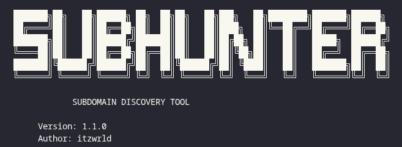

# SubFinderHunter

<p align="center">
  
</p>

<p align="center">
  **Subdomain Discovery & DNS Resolution Tool**
</p>

<p align="center">
  
  
  
</p>

---

## About

**SubFinderHunter** is a Python CLI tool designed for passive subdomain discovery using multiple public information sources.

It combines the collected results, removes duplicates and performs DNS resolution to identify associated IPv4 and IPv6 addresses.

The objective is to centralize passive reconnaissance in a single command-line tool.

## Features

- Passive subdomain discovery.
- Multiple public information sources.
- Automatic result aggregation.
- Duplicate removal.
- Automatic IPv4 DNS resolution.
- Optional IPv6 resolution.
- TXT result export.
- Separation of discovered and resolved subdomains.

## Data Sources

| Source | Description |
|---|---|
| [crt.sh](https://crt.sh/) | SSL/TLS certificate transparency |
| [AlienVault OTX](https://otx.alienvault.com/) | Passive DNS information |
| [HackerTarget](https://hackertarget.com/) | Public hostname lookup |

Source availability and results depend on provider limits and data coverage.

## Requirements

- Arch Linux
- Python 3.10+
- pipx
- Internet connection

## Installation

### 1. Clone the repository

```bash
git clone https://github.com/itzwrld/subfinderhunter.git
```

### 2. Enter the directory

```bash
cd subfinderhunter
```

### 3. Install dependencies

```bash
sudo pacman -S python python-pipx
```

### 4. Install SubFinderHunter

```bash
pipx install --editable .
```

### 5. Verify installation

```bash
subf --version
```

## Usage

SubFinderHunter uses the `subf` command.

### Basic syntax

```bash
subf -u <domain> [options]
```

### Available parameters

| Parameter | Description |
|---|---|
| `-u` | Target domain (required) |
| `-r` | Explicit IPv4 resolution (enabled by default) |
| `-ipv6` | Enable IPv6 resolution in addition to IPv4 |
| `--no-resolve` | Disable DNS resolution |
| `-o` | Specify output file |
| `--version` | Display tool version |
| `-h` | Display help |

### Examples

**1. Discover subdomains and resolve IPv4**

```bash
subf -u example.com
```

**2. Discover subdomains and resolve IPv4 and IPv6**

```bash
subf -u example.com -ipv6
```

**3. Discover subdomains without DNS resolution**

```bash
subf -u example.com --no-resolve
```

**4. Specify output file**

```bash
subf -u example.com -o results.txt
```

## Project Structure

```text
subfinderhunter/
├── assets/
│   └── subhunter-banner.png
├── results/
│   ├── .gitkeep
│   ├── subdomains.txt
│   └── resolved.txt
├── subf.py
├── sources.py
├── resolver.py
├── exporter.py
├── requirements.txt
├── pyproject.toml
├── README.md
└── .gitignore
```

| File | Description |
|---|---|
| `subf.py` | Main CLI entry point |
| `sources.py` | Public source integrations |
| `resolver.py` | DNS resolution |
| `exporter.py` | Result export functionality |
| `requirements.txt` | Python dependencies |
| `pyproject.toml` | Package and CLI configuration |

## Output

Results are stored in the `results/` directory.

**subdomains.txt**

Contains all discovered subdomains.

**resolved.txt**

Contains only subdomains with resolved IP addresses.

Example:

```text
api.example.com -> 192.0.2.10
mail.example.com -> 192.0.2.20
www.example.com -> 192.0.2.30
```

## Workflow

1. **Discovery:** Query public information sources.
2. **Aggregation:** Combine all collected subdomains.
3. **Deduplication:** Remove duplicate entries.
4. **DNS Resolution:** Resolve A and optionally AAAA records.
5. **Export:** Save results into TXT files.

## Disclaimer

SubFinderHunter is intended for authorized security research and educational purposes.

- Use only on domains you own or have permission to assess.
- DNS resolution does not guarantee HTTP/HTTPS service availability.
- Public data sources may have rate limits or incomplete information.

## Author

**itzwrld**

GitHub: [github.com/itzwrld](https://github.com/itzwrld)

## Repository

[https://github.com/itzwrld/subfinderhunter](https://github.com/itzwrld/subfinderhunter)
